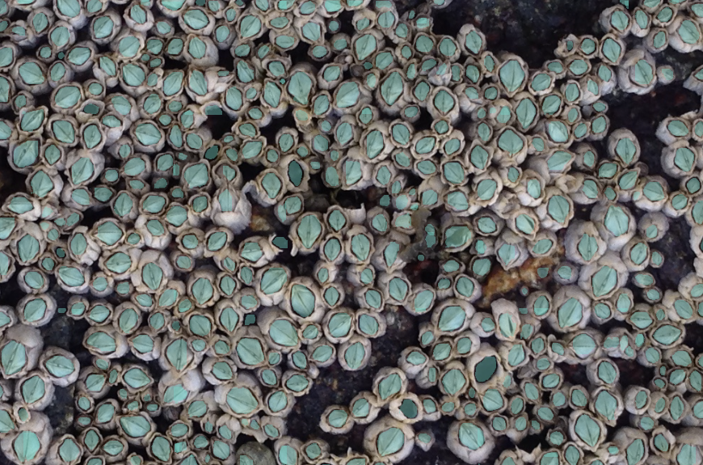

# Intertidal

### Barnacle instance segmentation and an interactive workbench for scientists



Intertidal is my DALI Lab submission: a prototype that helps scientists count and inspect barnacles in field photographs. It combines automatic region selection, a Mask R-CNN model with PointRend, and an interactive viewer for exploring predicted masks, counts, and size distributions. Starting from COCO-pretrained weights, I fine-tuned the model for **600 training steps** on tiles from one annotated photograph, with a second photograph reserved for validation. Validation mask AP increased from **9.60 at 200 steps to a best of 15.01 at 500 steps**; the final checkpoint achieved **14.46 AP, 40.41 AP50, and 6.16 AP75**. In my demo usage, inference took roughly **15–30 seconds on a T4 GPU**, with startup and image size affecting latency. These results support further development, while the small dataset and provisional annotations mean the predictions still need scientific review.

**Live demo:** public URL to be added.

[Training notebook](notebooks/barnacle_training_colab.ipynb)

## The problem and proposed solution

Counting densely packed barnacles by hand is slow, and a count alone does not show how individuals are distributed or how their sizes vary. I wanted to build a system that gives scientists an initial annotation they can inspect alongside the original photograph.

The workflow is simple: upload a photograph, select the analysis region, run inference, and explore the results. The workbench supports selectable masks, zoom and pan, confidence filtering, an instance table, and a size distribution. Scientists can export measurements as CSV or JSON and save an interactive HTML report.

The current viewer supports inspection; editing or deleting incorrect predictions is a future improvement. Measurements describe the annotated regions in pixels. The supplied outlines may represent barnacle openings rather than complete shells, so mask area should not be treated as whole-animal size or a physical measurement without annotation review and calibration.

## Critical subtasks

| Subtask | Input | Output |
| --- | --- | --- |
| Select the analysis region | A field photograph with a green quadrat frame, or an explicitly selected whole image | A region polygon and native-resolution crop for analysis |
| Prepare instance labels | Original photographs and the supplied blue-outline annotations | Instance masks, review overlays, and scene-separated COCO training and validation tiles |
| Segment and measure | Image tiles and the fine-tuned model | Confidence-scored instance masks, reconciled predictions across overlapping tiles, counts, and size summaries |

I implemented all three because a useful tool needs a complete path from the original photograph to measurements a scientist can inspect.

## Approach

### Region selection and data preparation

The preparation pipeline uses OpenCV and NumPy on CPU. It identifies the inside of the green frame using HSV color thresholds and geometric checks. Regions can also be selected manually, and already cropped photographs can use whole-image mode.

The supplied outlines are converted into instance labels, with ambiguous components flagged for review. Clean photographs are the model inputs; annotation overlays are used to construct labels and inspect results.

Images are divided into **640-pixel tiles with 25% overlap** at native resolution. The prepared dataset contains **9 training tiles from image 1 and 16 validation tiles from image 2**. Splitting by source photograph keeps overlapping tiles from the same image out of different splits. Tiling preserves small-object detail, but it does not turn two photographs into many independent scenes.

### Mask R-CNN with PointRend

I used a COCO-pretrained **Mask R-CNN with a ResNet-50/FPN backbone and PointRend**, adapted to one foreground class. Mask R-CNN predicts object boxes and individual masks; PointRend refines mask detail by focusing on uncertain points, including boundaries.

The configuration favors small, densely packed instances: anchor sizes range from **8 to 128 pixels**, and the prediction/evaluation limit is **600 detections per tile**. This avoids the usual 100-detection ceiling becoming a bottleneck in crowded tiles.

At inference time, a separate overlap-reconciliation stage suppresses duplicate predictions across tiles. The viewer reports counts, mask areas, centroids, equivalent-circle diameters, coverage, and boundary flags. Masks touching region or internal tile boundaries are excluded from complete-size summaries, although they remain in the count.

Classical image processing was useful for detecting the frame and extracting supplied outlines. I chose learned instance segmentation for separating barnacles in varied textures and lighting. A plain Mask R-CNN and classical segmentation would be useful comparison baselines; I did not run a controlled benchmark of three approaches.

## Evaluation and results

The main evaluation task is **instance segmentation on the held-out photograph**. The saved outputs in the [training notebook](notebooks/barnacle_training_colab.ipynb) provide the results below.

### Metrics

| Metric | What it tells me |
| --- | --- |
| Mask AP | Average precision across mask intersection-over-union (IoU) thresholds from 0.50 to 0.95; the main checkpoint-selection metric |
| Mask AP50 | Average precision at IoU 0.50, allowing a looser mask match |
| Mask AP75 | Average precision at IoU 0.75, requiring closer agreement with the reference mask |
| Bounding-box AP | Detection quality across IoU thresholds, evaluated on boxes rather than masks |
| Mask AR@600 | Average recall across IoU thresholds, allowing up to 600 detections per tile |
| Training loss | An optimization diagnostic for whether training is progressing; it does not establish generalization by itself |

IoU measures overlap between a prediction and its reference. AP values below use a **0–100 scale**; AR uses **0–1**. AP50 is not the percentage of barnacles counted correctly. These results use a 600-detection evaluation cap, which should be considered when comparing them with other runs.

### Recorded performance

| Training steps | Mask AP | Mask AP50 | Mask AP75 | Box AP | Mask AR@600 |
| --- | ---: | ---: | ---: | ---: | ---: |
| 200 | 9.60 | 29.84 | 2.01 | 10.28 | — |
| 400 | 14.30 | 41.43 | 6.04 | 14.10 | 0.353 |
| 600 | 14.46 | 40.41 | 6.16 | 15.50 | 0.344 |

The **best validation mask AP was 15.01 at step 500**, saved as `model_best.pth`. The unseen-image demo used the **600-step `model_final.pth`**, so the final-checkpoint scores describe that demo model. Steps are training iterations, not epochs.

The final checkpoint also achieved **14.72 small-object mask AP** and **31.31 medium-object mask AP**. Large-object AP was unavailable in this evaluation; it should not be interpreted as zero.

### What the results show

Mask AP improved by **4.86 points from step 200 to step 600**, showing that fine-tuning helped on the held-out photograph. Improvement slowed after step 400, and the best checkpoint occurred before the final step. More training therefore did not consistently improve validation performance.

AP50 is substantially higher than AP75. This suggests that the model finds useful approximate regions more often than it produces masks with tight agreement to the supplied annotations. The remaining errors matter for both counting and size measurement, and the metrics support using this as a prototype that needs review.

### Limits of this evaluation

- **Only two annotated source photographs:** one supplies training data and one supplies validation data. The results do not establish performance across species, sites, camera setups, or lighting conditions.
- **Provisional labels:** outline extraction, annotation completeness, and the anatomical target still need review. Scores measure agreement with those supplied labels.
- **No labeled unseen test set:** the two unseen images demonstrate inference and visualization, but their predicted counts are not accuracy measurements.
- **No measured count error or analyst time savings:** count MAE, size-measurement error, and a timed comparison with manual annotation would be useful next evaluations. The 15–30-second inference time is an observation from my usage, not a formal latency benchmark.

Training loss helps diagnose optimization, while held-out AP helps track generalization. A gap between training and validation performance could suggest overfitting, but I have not reported a measured training-versus-validation loss gap here. With more independently annotated photographs, I would use cross-validation grouped by source photograph or collection site and retain a separate final test set.

## Conclusions and next steps

I think this approach is worth pursuing. The prototype connects automated segmentation with a visual way to inspect predictions and export measurements. The initial fine-tuning gains are encouraging, while tighter masks and broader validation remain necessary before scientists can rely on the measurements.

The improvements I would prioritize are:

1. **Review labels and collect more independent images.** Include different species, densities, lighting conditions, and camera scales, with a clearly defined annotation target.
2. **Add correction tools.** Let scientists delete or edit masks and save reviewed corrections as training examples for later fine-tuning.
3. **Test larger anchors and scale settings.** The current anchor configuration tops out at 128 pixels. That is not a hard maximum object size, but larger anchors or a different scale policy may help with large barnacles in close-up photographs.
4. **Evaluate the scientific outputs directly.** Measure full-image count error after duplicate reconciliation, mask/size error, threshold sensitivity, and time saved during a reviewed annotation workflow.
5. **Tune training and inference with evidence.** Compare checkpoints and baselines, then test whether additional training or faster hardware improves quality or turnaround time enough to justify the cost.

## What I learned

This project made the R-CNN family much more concrete for me. I learned to follow a tile through region proposals, box prediction, mask prediction, and PointRend refinement, and to connect those stages to the training losses and configuration settings. Looking at the segmentation overlays was one of my favorite parts of the project.

I also learned that tiling is more than cropping an image: overlap creates duplicate predictions, boundaries can truncate objects, and evaluation needs to respect the original source photographs. PointRend refines individual masks; reconciliation across tile borders is a separate part of the pipeline.

The biggest takeaway was learning to read the metrics alongside the visual results. Better-looking overlays, lower training loss, or more predicted instances do not automatically mean better performance. The best-versus-final checkpoint comparison helped me see why validation matters.

## Explore and run the project

| Resource | Purpose |
| --- | --- |
| [Training notebook](notebooks/barnacle_training_colab.ipynb) | Colab setup, fine-tuning, and recorded evaluation outputs |
| [Scientist demo notebook](notebooks/barnacle_scientist_demo.ipynb) | Launch the interactive workbench in a connected Colab runtime |
| [Training guide](docs/COLAB_TRAINING.md) | Training configuration and workflow |
| [Preparation guide](docs/PRETRAINING.md) | Region selection, label review, dataset generation, and validation |
| [Unseen-image guide](docs/UNSEEN_DEMO.md) | Checkpoint export and tiled inference on the supplied unseen images |
| [Source package](src/barnacle_challenge) | Region selection, annotations, datasets, inference reconciliation, and measurements |
| [Training and viewer code](training) | Model training, inference entry points, and the interactive viewer |

To prepare and structurally validate the dataset from the repository root using the existing Windows virtual environment:

```powershell
.\.venv\Scripts\python.exe -m barnacle_challenge prepare-data --output artifacts/pretraining
.\.venv\Scripts\python.exe -m barnacle_challenge validate-data artifacts/pretraining
```

Use a new output directory if `artifacts/pretraining` already exists. Structural validation checks the dataset format and consistency; label and region review are still needed. Preparation runs on CPU; the training notebook uses a GPU runtime.
